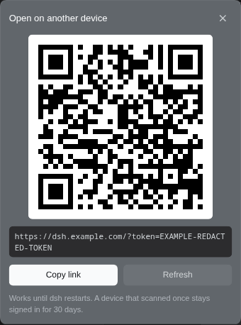
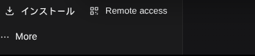

# rdsh-remote-link

A DeepSeek Harness plugin: one button in the sidebar foot that shows this Web GUI's **tokenized URL** and a **QR code**, so a phone or another device can pair by scanning instead of retyping a launch token.

It works with any Web profile. The URL is whatever the Host advertises — no hardcoded host, port, scheme, or path.



## The problem

`dsh web` prints `http://host:port/?token=…` once at launch. That URL is gone from the terminal as soon as it scrolls, is miserable to type on a phone, and often names a host the phone cannot reach because the desktop was opened through `localhost`.

## What it does

| Half | Responsibility |
|---|---|
| Host (`index.js`) | Serves `GET /api/remote-link` with `{ url, source, warning?, svg }`. The URL is `ctx.connection.authenticatedUrl(<root>)` — the same call `dsh web` uses for the URL it prints and opens — and the QR is an SVG of that URL. |
| Browser (`client.js`) | Registers one action in `sidebar.footer.action` beside Settings, plus the panel in `shell.overlay`. It fetches on every open, and closes on Escape or an outside click. |

The panel is lifted into the browser's top layer where the Popover API exists, so it is never clipped by the sidebar column and never sits under a mobile drawer.

A QR code only helps the device that is *not* showing it, so the panel hides it below 760px: a phone gets the URL and the copy button, a desktop gets the QR the phone scans.

It sits in the sidebar foot, beside Settings:



## Install

Install this directory as a bundle into the profile that serves the Web UI — Settings → Plugins, or from an agent session with `plugin_manager` (`install_bundle`, target = this directory). It takes effect without a restart; if the row does not activate, toggle the bundle once.

There are no dependencies: the QR encoder is vendored.

## Which URL it hands out

The root is chosen in this order, and `source` in the response says which rule fired:

| Deployment | Root |
|---|---|
| `config.publicUrl` | that value, normalized to end in `/` |
| `--public-url`, or any non-loopback advertised root | that URL unchanged — scheme, port, and mount kept |
| listener bound to a LAN or Tailnet address | the listener origin |
| loopback listener behind `--trusted-host` | `tailscale status --json` → `Self.DNSName`, listener port, listener scheme |
| loopback without trusted hosts | the loopback origin plus a `loopbackOnly` warning; `tailscale` is never run |
| Tailscale missing or failing | the loopback origin plus a `tailscaleUnavailable` warning |

`config.publicUrl` is an optional row-config string for a deployment whose external root is neither the advertised one nor a Tailscale name. It has no schema, so it is validated at request time and ignored with a console warning when unusable.

## About the token

- The Host mints one launch token per process. The plugin never stores, logs, or caches it: every open asks for a fresh authenticated URL, and the answer carries `cache-control: no-store`.
- Opening the URL once exchanges the token for a signed cookie (30 days by default) bound to that exact hostname and port, then redirects to the clean URL. A device that scanned once keeps its session across restarts.
- The route lives inside Connection's browser-authentication fence, and exact Fetch routes refuse non-owner peers, so a liveshare viewer cannot read the token.
- Mutating the current origin is never used: if the desktop opened `http://127.0.0.1:3080` and the deployment advertises `https://dsh.example.com`, the QR carries the latter.

## Requirements

- A Web profile: the plugin injects `connection`, `webApp`, and `webServer`, so other profiles leave it inactive.
- Any current Chromium, Safari 17+, or Firefox 125+ for the top-layer stacking. Older engines keep the panel inside `shell.overlay`: still unclipped, but a phone drawer paints over it.

## Tests

```sh
npm test
```

Covers the deployment matrix above (including mount prefixes, scheme preservation, IPv6 loopback, a TLS listener, and a missing `tailscale`), the route shape, and that the QR encodes the tokenized URL.

## Security

The URL is a bearer credential. Anyone who sees the QR can sign in as the owner until its cookie expires, so treat screenshots and screen shares like passwords.

Plain HTTP exposes the token and the cookie on the wire; terminate TLS at the listener (`--tls-cert`) or keep the traffic inside a private network such as Tailscale or WireGuard.

## License

MIT. `vendor/qrcode.js` is `qrcode-svg` 1.1.0 (MIT), itself derived from Kazuhiko Arase's "QRCode for JavaScript"; see `vendor/LICENSE-qrcode-svg`.
